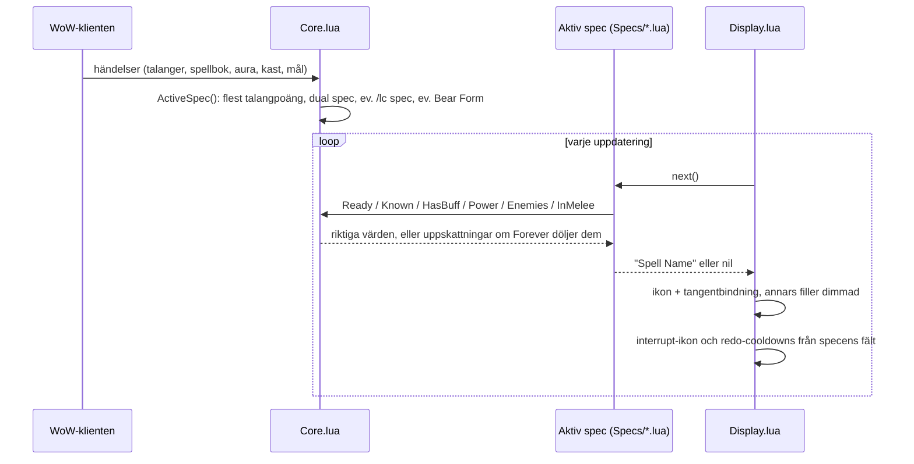

# LLD – LevelCoach

> Hur addonen är byggd, så att den kan ändras säkert. Uppdateras i samma PR som koden (Claude-skill: `lld-update`).
> Användarguiden finns i [README](https://github.com/JoseMdS/LevelCoach#readme).

## 1. Syfte och avgränsning
LevelCoach visar en stor ikon med nästa förmåga att trycka under leveling i WoW Forever, en röd ikon när målets cast kan avbrytas och en rad med cooldowns som är redo. Den trycker aldrig på något själv. På klasser och specs utan rotation stänger addonen av sig helt.

## 2. Komponenter och filer
Laddningsordningen styrs av `.toc`: `Core.lua`, `Swing.lua`, alla `Specs/*.lua`, sist `Display.lua`. Modulerna delar addon-namnrymden `ns`.

| Del | Fil | Ansvar |
|---|---|---|
| Addon | `LevelCoach.toc`, `LevelCoach_Forever.toc`, `LevelCoach_Camelot.toc` | Samma innehåll i tre filer så att klientvarianterna hittar addonen. Interface `16001, 11507`, `SavedVariables: LevelCoachDB` |
| Kärna | `Core.lua` | Spec-register (`ns.RegisterSpec`), talangpoäng och aktiv spec (`TreePoints`, `MainTree`, `ActiveSpec`), spellbok och uppslag på namn (`ScanSpellbook`, `ID`, `Known`), resurser, hälsa, cooldowns, buffar och dots, uppskattningar när data döljs, fiender i närheten |
| Swing-timer | `Swing.lua` | Huvud- och offhand-slag från stridsloggen (bara Classic Era; Forever ger inte addons stridsloggen) |
| Rotationer | `Specs/<Klass><Spec>.lua` | En fil per spec som anropar `ns.RegisterSpec{…}`. Första raden avbryter för andra klasser |
| Visning | `Display.lua` | Ikonen, avbrottsikonen, cooldown-raden, resurstext, slash-kommandon (`/lc`, `/levelcoach`), avstängning när ingen spec passar |

## 3. Flöden

## 4. Gränssnitt

### Spec-kontraktet (`ns.RegisterSpec`)
| Fält | Betydelse |
|---|---|
| `class`, `tree`, `name` | Klass, talangträd (1–3) och namn |
| `default` | Används före talangpoäng (under nivå 10) |
| `when` | Valfritt extra villkor, t.ex. Bear Form för bear-specen |
| `ranged` | Caster/hunter: räkna fiender via hot, anta inte melee |
| `spells` | Förmågor som spåras (för cooldowns och uppskattningar) |
| `melee` | Förmågor som testar melee-avstånd |
| `filler` | Kärnförmåga som visas dimmad när inget annat passar |
| `interrupt` | Avbrottsförmågan |
| `cooldowns` | Raden med redo-cooldowns |
| `resource()` | Text och färg under ikonen |
| `next()` | Returnerar namnet på nästa förmåga eller `nil` |

Ny spec: skapa `Specs/<Klass><Spec>.lua` (kopiera en befintlig) och lägg den i alla tre `.toc` före `Display.lua`.

### Slash-kommandon
`/lc` (status och hjälp), `lock`/`unlock`, `scale <n>`, `cds`, `swing`, `mode auto|leveling|endgame`, `debug`, `twist`, `keys`, `always`, `reset`, `shred`, `spells`, `talents`, `spec <namn>|auto`.

## 5. Data
- `LevelCoachDB` (SavedVariables): position och låsning, skala, och växlarna för cooldowns, swing, läge, twist, tangenttext, alltid synlig, shred och tvingad spec.
- I minnet: spellboken (namn → högsta rang), senaste kast per förmåga, uppskattad resurs, spårade buffar och dots med normal varaktighet.

## 6. Test och kvalitet
- Manuellt i spelet per klass. `/lc spells` visar vilka förmågor som hittades, `/lc debug` vad spelet döljer.
- CI: `docs.yml` kontrollerar dokumentationen. Lua-tester finns inte ännu.

## 7. Kända begränsningar
- Arms, Subtlety, Balance och healers har ingen rotation ([LC-KRAV-006](https://github.com/JoseMdS/LevelCoach/issues/8)).
- Ingen påminnelse om gift för rogue, eftersom gifter är föremål i Classic ([LC-KRAV-007](https://github.com/JoseMdS/LevelCoach/issues/11)).
- Forever ger inte addons stridsloggen: ingen swing-timer, ingen seal twisting för Ret och ingen Slam för Fury där.
- Forevers klassändringar rör sig fortfarande; omdöpta förmågor syns som "not found" i `/lc spells` ([LC-KRAV-009](https://github.com/JoseMdS/LevelCoach/issues/15)).
- Interface 16001 är inte bekräftat av Blizzard ([LC-KRAV-010](https://github.com/JoseMdS/LevelCoach/issues/17)).

## 8. Spårbarhet
| Krav | Var i koden | Test |
|---|---|---|
| [LC-KRAV-001](https://github.com/JoseMdS/LevelCoach/issues/2) Ikon, avbrott | `Display.lua`, specens `interrupt` | manuellt |
| [LC-KRAV-002](https://github.com/JoseMdS/LevelCoach/issues/3) Spec från talanger | `Core.lua`: `TreePoints`, `MainTree`, `ActiveSpec` | `/lc talents` |
| [LC-KRAV-003](https://github.com/JoseMdS/LevelCoach/issues/4) Leveling/endgame | `Display.lua` (`/lc mode`), specs | manuellt |
| [LC-KRAV-004](https://github.com/JoseMdS/LevelCoach/issues/6) Rotationer | `Specs/*.lua` | manuellt per klass |
| [LC-KRAV-005](https://github.com/JoseMdS/LevelCoach/issues/7) Maelstrom 3+ | `Specs/ShamanEnhancement.lua` | manuellt |
| [LC-KRAV-008](https://github.com/JoseMdS/LevelCoach/issues/14) Uppskattning när data döljs | `Core.lua`: `Clean`, `SinceCast`, `DurFor`, resursuppskattning; [ADR-0002](adr/0002-namnuppslag-och-uppskattning.md) | `/lc debug` |
